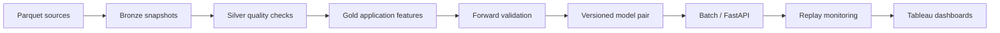

# Home Credit Risk & Stability Platform

A reproducible data engineering and machine learning project for **credit-risk prediction across time**. It turns multi-grain Parquet sources into one row per application, compares models using forward validation, serves versioned scores, and exports risk, stability, quality, and operational metrics to Tableau.

Built around the [Home Credit — Credit Risk Model Stability competition](https://www.kaggle.com/competitions/home-credit-credit-risk-model-stability). This is a historical-data engineering prototype, not a lending decision system.


## Start here

| I want to… | Open |
|---|---|
| Run a complete example in minutes | [Quick start](#quick-start) |
| Understand the design | [Architecture](docs/architecture.md) |
| Inspect measured results and limitations | [Results](reports/RESULTS.md) · [Model card](docs/model-card.md) |
| Use the competition data | [Data guide](docs/data-dictionary.md) |
| Open the four-page dashboard | [Tableau guide](bi/README.md) |
| Recover a run or roll back models | [Runbook](docs/runbook.md) |
| Review what was verified | [Acceptance evidence](docs/acceptance.md) |

## Quick start

Python 3.10–3.12. On macOS, LightGBM may need `brew install libomp`.

```bash
python3 -m venv .venv
source .venv/bin/activate
pip install -e '.[dev]'
home-credit demo --output artifacts/demo
pytest -q
```

The demo creates 3,200 **fictional** applications across 32 weeks, ingests four sources, builds features, compares logistic regression and LightGBM, evaluates an untouched final period, activates a full/internal model pair, and writes monitoring tables. No Kaggle account is needed for the demo.

```bash
# Train with locally downloaded competition data:
home-credit run --config configs/kaggle.yaml --output artifacts/competition

# Score application-level features using the same preprocessing as training:
home-credit score --input artifacts/competition/data/gold.parquet \
  --registry artifacts/competition/registry --output artifacts/scores.parquet

# Start the local scoring API; interactive contract at /docs:
HOME_CREDIT_REGISTRY=artifacts/competition/registry \
  uvicorn home_credit.api:app --host 127.0.0.1 --port 8000
```

## What the project implements

- **Data engineering:** content-addressed Bronze snapshots, explicit table grains, orphan and duplicate checks, projected Parquet reads, Silver normalization, parent-balanced depth-two aggregation, and Gold uniqueness checks in Python and DuckDB.
- **Model engineering:** train-only imputation/encoding, three expanding temporal folds, baseline/LightGBM comparison, untouched final four-week holdout, weekly AUC/Gini, Brier score, stability metric, and versioned bundles.
- **Operations:** batch/API scoring parity, separately evaluated internal-source fallback, explicit model activation and rollback, week-scoped backfill, run manifests, configurable simulated label delay, missingness and PSI monitoring.
- **Delivery:** a Tableau workbook generator and four-page workbook, reproducible metrics, Docker image definition, optional Prefect/MLflow integrations, and GitHub Actions checks.



## Repository map

```text
src/home_credit/     Pipeline, features, training, API, monitoring, CLI
configs/             Explicit competition source and feature selection
scripts/             Dashboard generation and verification evidence
tests/              Data, temporal validation, API and recovery tests
bi/                  Tableau workbook and usage guide
reports/             Aggregate results and small synthetic summaries
docs/                Architecture, data contract, model card and runbook
.github/workflows/   Continuous integration
```

Raw data, per-application predictions, serialized models, credentials, and runtime artifacts are excluded from Git. The competition download is local-only. Committed synthetic data and aggregate reports are explicitly labeled.

## Reproducibility and scope

The real-data configuration uses all application rows and a curated feature subset, rather than every available competition column. Data hashes, selected schemas, feature version, source-code fingerprint, parameters, seed, and model versions are recorded. `requirements-lock.txt` records the tested local environment; use the package version ranges for cross-platform installation.

Date availability and label maturity cannot be proven from these historical tables. The two-week label delay is a demonstration assumption. Category histories use distinct counts; date intervals use decision date only when date columns are explicitly selected. The final holdout is never used to pick a candidate. Undefined or undersized weeks make the stability score unavailable rather than silently disappearing.

Local model activation is an engineering gate (valid evaluation and compatible artifacts), not an automatic approval for real lending. No leaderboard rank, financial benefit, fairness certification, or production deployment is claimed.
