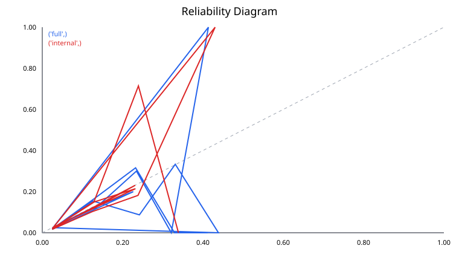
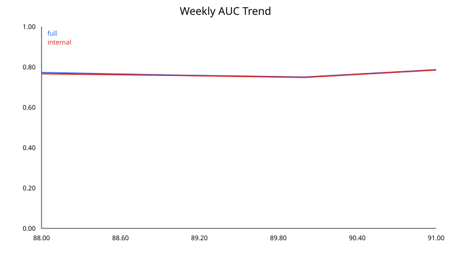

# Model Validation Report

> Evidence classification: **RETROSPECTIVE REAL-DATA RUN**. This report is generated from run artifacts.

## 1. Executive Summary

The validation framework covers discrimination, calibration, temporal behavior, segment robustness, data/score drift, and operational score parity; unavailable evidence is identified below. It is a research and engineering review, not approval for lending, a production-readiness statement, or a regulatory certification.

## 2. Data Provenance & Quality

- Data version: `1d2ae54ea09d1723`
- Feature version: `aggregate-v1`
- Source type: historical Kaggle competition data
- Point-in-time feature availability and real label maturity: **not assessed / unavailable**.

## 3. Model & Feature Methodology

Logistic regression and LightGBM candidates use train-only preprocessing. Full and internal fallback models are selected and versioned separately. The legacy `score` remains the raw model probability; `calibrated_score` is an additional, reversible output.

## 4. Validation Design

Three expanding temporal folds are used for model selection and out-of-time calibration predictions. Calibration method selection stays within development data. The final four weeks are a retrospective, previously inspected evaluation period, not a newly untouched independent test.

## 5. Discrimination & Calibration

| Mode | AUC | Gini | Brier | Log loss | ECE | O/E | Stability |
|---|---:|---:|---:|---:|---:|---:|---:|
| full | 0.767139 | 0.534277 | 0.021428 | unavailable | unavailable | unavailable | 0.521721 |
| internal | 0.764634 | 0.529267 | 0.021461 | unavailable | unavailable | unavailable | 0.516981 |

Calibration comparison evidence: unavailable.

## 6. Segment Performance

Segment evidence is unavailable; fairness was not assessed.

## 7. Stability & Drift

The legacy artifact includes weekly performance, numeric feature PSI, missingness and coverage; categorical PSI and raw/calibrated score PSI are unavailable until a new run.
PSI > 0.2 is an explanatory example threshold, not an automatic approval or retraining rule.
The run produced 0 traceable alert rows.

## 8. Operational Verification

The committed legacy run verifies raw-score batch/API parity and paired Full/Internal activation/rollback. Calibrator parity and binding are unavailable for this pre-extension artifact; they are exercised by the current synthetic test suite.

## 9. Limitations & Risks

- Historical feature arrival times cannot be verified from `WEEK_NUM` alone.
- Label delay is simulated and must not be interpreted as observed production maturity.
- The curated feature set is limited; protected attributes and fairness mechanisms are absent.
- The final weeks have already been inspected and reported; a new independent test requires later data.
- Scores are not validated 12-month PDs and are not suitable for real loan approval.

## 10. Validation Conclusion & Action Items

Engineering checks are reproducible from the cited artifacts. Statistical results remain conditional on this historical/synthetic scope. Before real-world use, obtain a genuinely new time period, point-in-time lineage, real label-maturity evidence, independent governance review, and an appropriate fairness assessment.

## Evidence Index

- `evaluation.json`: versions, temporal experiments, retrospective holdout metrics
- `data/manifest.json`: data hashes, schemas and provenance (when retained with the run)
- `bi/calibration_comparison.csv`: raw versus calibrated metrics
- `bi/calibration_weekly.csv`: fixed-bin reliability evidence and event counts
- `bi/segment_performance.csv`: frozen segment definitions and metrics
- `bi/model_performance_weekly.csv`: weekly performance and calibration
- `bi/data_quality_weekly.csv`: feature drift, missingness and coverage
- `bi/score_stability_weekly.csv`: score distribution drift
- `bi/stability_alerts.csv`: threshold, week, model and reference lineage
