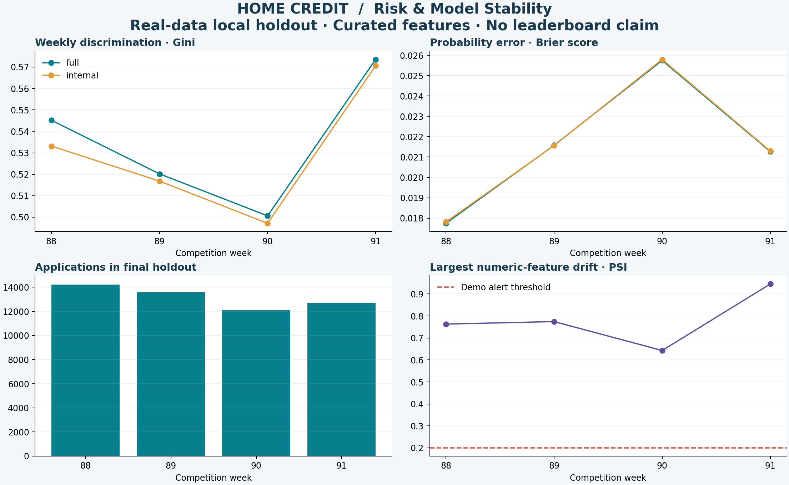

# Measured results

**Run date: October 24, 2026.** These are local, retrospective results on the supplied competition training data, not leaderboard scores or production lending outcomes.

## Dataset and split

- 1,526,659 applications across competition weeks 0–91; no application-row sampling.
- 52,611 applications in the untouched final holdout, weeks 88–91.
- Selected static features plus person, external bureau and depth-two prior-application histories; 35 engineered features in the full model.
- Source rows: 1,526,659 static; 2,973,991 person; 85,791 bureau; 14,075,487 depth-two previous records.
- Three expanding validation folds: train through weeks 75/79/83, validate on 76–79/80–83/84–87. Final fits use weeks 0–87.

## Final holdout

| Model mode | AUC | Brier ↓ | Stability ↑ | Weekly Gini slope |
|---|---:|---:|---:|---:|
| Full sources | 0.767139 | 0.021428 | 0.521721 | 0.006552 |
| Internal fallback | 0.764634 | 0.021461 | 0.516981 | 0.009264 |

All four holdout weeks have defined Gini. Source-outage fallback reduces AUC by approximately 0.0025 on this holdout. That is an observed difference, not a claim of statistical significance.

## Development-only feature experiments

These exploratory comparisons use the three development-validation folds only. Their scores are means of fold metrics, not overall holdout metrics. They do not change the already-frozen final candidate or reuse the holdout for tuning.

| Feature/training variant | Mean validation AUC | Mean fold stability | Features |
|---|---:|---:|---:|
| Static only | 0.72001 | 0.41414 | 10 |
| Add history | 0.75323 | 0.48232 | 35 |
| Keep stable missingness | 0.62569 | 0.24337 | 29 |
| Recent-time weighting | 0.75524 | 0.48948 | 35 |

The selected missingness-stability rule materially hurts discrimination. Recent-time weighting gives a small validation gain that has not been independently confirmed on a new untouched test period. Neither is presented as a proven production improvement.

## Engineering measurements

- Final full-data run: **136.63 seconds**, peak process RSS **3,932 MB**, macOS 26.6.2 / Apple ARM64. Includes source snapshot copying, features, candidate training and reports. Other local workloads were running; this is a single observation, not a benchmark distribution.
- API verification: **30 serial in-process requests × 100 rows**, P95 **22.87 ms**, approximately **5,974 rows/sec**. Includes bundle loading and request handling; excludes network transport and concurrent-client load.
- API/batch maximum score difference: **0.0** on the verification sample.
- Explicit external-source fallback, modified-row backfill equivalence, failed-run audit, and rollback between distinct version identifiers all passed.
- Docker API: live health endpoint returned ready; HTTP scores matched local batch scores exactly on three verification records.
- Automated tests: **14 passed**. Optional MLflow and Prefect integrations were exercised on synthetic data.

Machine-readable evidence: [evaluation](competition/evaluation.json), [verification](competition/verification.json), [dataset scope](competition/dataset-summary.json), [ablations](competition/ablations.csv), [run metrics](competition/bi/pipeline_runs.csv). The [reporting guide](REPORTING.md) explains the chart and aggregate CSVs.

## Synthetic demonstration

The separate [demo results](demo/evaluation.json) use 3,200 fictional applications and test engineering behavior. Their distributions and scores are unrelated to competition performance. Negative stability results in the demo are retained, not suppressed.

## Scope and limitations

The reporting deliverables are a Python-generated model-stability chart and machine-readable aggregate CSV summaries. No interactive dashboard or managed cloud deployment is included. Historical source timing, real label maturity, fairness, production calibration, model governance and operational service-level objectives require separate validation before real lending use.
